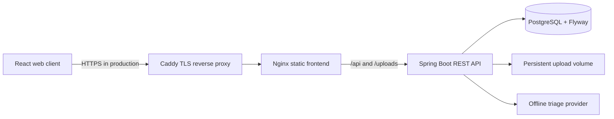

# QuickerFix

QuickerFix is a full stack civic issue reporting and service coordination platform. It gives residents a clear way to report local problems, helps public service administrators prioritize and assign work, and lets field teams record repairs with evidence. This document describes the complete product scope, the security expectations, how the current build behaves, and the features still on the implementation roadmap.

**Implementation status is tracked in [IMPLEMENTATION_MAP.md](IMPLEMENTATION_MAP.md).** Labels below distinguish working flows from planned work so the product vision is not mistaken for a claim that every integration is already deployed.

## Product goals

- Make civic issues visible, traceable, and easier to route to the responsible service team.
- Keep residents informed from submission through review, assignment, work, and resolution confirmation.
- Help administrators use consistent priorities and decision support while retaining human control.
- Give workers a focused, mobile-friendly field workflow with proof of completed work.
- Publish useful announcements and a source-attributed directory of emergency and authority contacts.
- Keep personal data limited, protect accounts and private communication, and make operational behavior measurable.

## User roles

### Public entry and sign-in

The homepage presents three direct portal entry cards: **Citizen Portal** (report and track civic issues), **Municipal Worker Portal** (view and update assigned field tasks), and **Administrator Portal** (dispatch work, oversee departments, and manage the priority queue). Each card opens the matching role tab at `/login?role=citizen`, `/login?role=worker`, or `/login?role=admin`. The login form supports password authentication and Google sign-in where configured. The requested tab is only a sign-in hint: the backend account role in the authenticated JWT session determines the destination (`/citizen`, `/worker`, or `/admin`) and authorization.

### Resident / citizen

- Create an account using email and password, or Google sign-in when configured. Aadhaar collection and Aadhaar/OTP authentication are not part of this product.
- Submit an issue with category, severity, title, details, address, optional browser location, and evidence photos.
- View the public issue feed, personal reports, and nearby open reports; support issues with an upvote and add relevant comments.
- Follow the status timeline and worker completion evidence; confirm the fix or reopen the issue with a reason.
- Browse public announcements and source-linked emergency contacts.
- **Planned:** location map browsing, an in-app rating flow after closure, richer notification preferences, and improved accessibility/mobile testing.

### Administrator / authority staff

- Enter the platform through controlled administrator provisioning. Public registration cannot create administrators or workers.
- Review reports, filter queues, set verified categories and statuses, and assign staff to a service area or department.
- Create and manage worker accounts, departments, issue categories, and authority directory entries.
- Publish global or targeted notices and withdraw outdated notices.
- Review explainable AI triage recommendations, then accept or change them; suggestions never modify a report on their own.
- Review duplicate candidates and explicitly link reports while preserving both submissions.
- Review operational analytics for status/category mix, backlog age, and resolution time.
- **Planned:** a verified official designation and authority-profile workflow, configurable escalation policies, advanced audit views, and privacy-safe performance reports.

### Field worker

- View assigned tasks and their issue details, accept or decline with a reason, and track assignment progress.
- Submit a completion photograph and work note; the resident then verifies the repair or reopens the issue.
- **Planned:** route-aware work planning, offline/mobile field support, and a complete long-term work history/performance workspace.

## Report lifecycle

The intended end-to-end workflow is:

```text
REPORTED -> UNDER_REVIEW -> VERIFIED -> ASSIGNED -> IN_PROGRESS
          -> RESOLVED -> CITIZEN_VERIFICATION -> CLOSED
                                      `-> REOPENED -> IN_PROGRESS
```

The API records lifecycle actor, time, status change, and remarks. Only the assigned worker can accept and submit work; only the report owner can confirm or reject completion. Administrators review, verify, prioritize, and assign. Illegal status transitions and unauthorized actions are rejected.

## Functional scope

### Issue intake and community visibility

- Structured reports with categories, severity, description, address, and optional coordinates.
- Image evidence with extension, MIME type, signature, and 10 MB per-file checks; a report accepts up to five photos.
- Paginated report queues and public browsing, with search and category/status filters where supported.
- Nearby reports based on browser geolocation and a bounded radius; the resident workspace currently requests reports within 500 m.
- Comments, community upvotes, a status timeline, and explicit administrator-managed duplicate links.
- **Planned:** configurable map layers, service-boundary geofencing, map-based queue review, and rules for location-based routing. Google Maps requires a browser API key; mapping and route optimization are not prerequisites for reporting.

### AI decision support

- An offline Naive Bayes classifier suggests category and severity from civic-language examples and displays confidence, rationale, and alternatives.
- The system minimizes/redacts common contact and identity patterns before classification; administrators must review and choose the final values.
- Decisions are audited without persisting the source report text again. Per-administrator triage requests are rate limited.
- **Optional future integration:** a remote model can be added behind the provider interface, with privacy review and separate credentials. No external AI provider is required for local triage.
- **Planned evaluation:** measure accuracy, low-confidence coverage, latency, and failure cases using a labeled, privacy-safe set before making quality claims.

### Duplicate review and prioritization

- Similarity suggestions consider open reports in the same category, up to 30 days old and within 500 m, bounded to 200 database candidates and the top 10 results.
- Results show distance, text overlap, and a short reason. Only an administrator can link a duplicate; submissions are not merged or deleted automatically.
- The priority queue orders reports using the configured severity, age, duplicate count, and community support score. Do not interpret this as a validated service-level guarantee.

### Announcements and notifications

- Public noticeboard for active announcements, including global, category, and district targeting, priority, expiration, read tracking, publication, and withdrawal.
- In-app notifications are persisted for signed-in users and scoped to their account.
- **Planned:** real-time push/WebSocket delivery, email/SMS provider integration, notification preferences, reminders, and configurable urgent-issue escalation. A mail dependency or chat widget alone does not mean these delivery channels are configured.

### Chat and contact directory

- Report-scoped REST chat services enforce report-participant access and message length limits. A chat UI component exists but is not yet connected to the report-detail workflow.
- **Planned:** complete chat UI integration, authenticated live message delivery, unread state, and typing indicators.
- Public emergency contacts support state, district, and service filters, tap-to-call, scope, instructions, official source links, and verification dates. Administrators can maintain records.
- The initial contacts cover India-wide emergency services and Jharkhand state-wide authorities. District-specific contacts can be added after checking an official source. Administrators should review changing phone numbers and source URLs.
- The contact directory is informational and does not dispatch or monitor emergencies. Call the appropriate official emergency service directly when immediate help is required.

### Analytics and operations

- Administrator analytics include counts by status and category, active-report age buckets, and median/p90 closed-report duration.
- Analytics accept date/category filters, label low samples, and cap the resolution-time sample to the most recent 1,000 records.
- **Planned:** representative load/performance measurements, production database query-plan review, alerting, and long-term trends.

## Security and privacy requirements

The project uses these controls or explicit deployment requirements. A checkmark is limited to the described scope; it is not a claim of an external certification.

- **JWT authentication — implemented:** signed bearer tokens expire after 24 hours. Invalid/expired tokens are rejected. Disabling an account prevents further use of its existing token on the next request. Tokens are held in browser local storage, so preventing cross-site scripting and protecting devices remains important; refresh-token rotation and server-side revocation are future work.
- **Role-based access control — implemented:** citizen, worker, and administrator roles are enforced at API routes and method/service boundaries. A public signup request always creates a citizen account.
- **Administrator access gate — implemented with a defined limit:** the first administrator must be explicitly provisioned from startup environment settings; additional staff accounts are administrator-controlled. The app does not validate government employment or official designation against a government source. That external verification workflow is planned and must not be advertised as automatic.
- **Password storage — implemented:** passwords are BCrypt-hashed and never stored as reversible plaintext. Citizen passwords require at least 12 characters; staff provisioning uses a strong password requirement.
- **Sensitive data at rest — implemented for selected fields:** user phone numbers and private chat message content use AES-256-GCM authenticated encryption in the database. Existing plaintext values are converted in bounded batches on startup. `DATA_ENCRYPTION_KEY` must be a private, stable Base64-encoded 32-byte key; back it up securely and do not commit a production key. Key rotation needs a controlled decrypt/re-encrypt procedure. Passwords are hashed rather than encrypted. Civic report descriptions, addresses, coordinates, names shown in public timelines, and uploaded issue photos can be visible through public report views; residents should not include secrets or unrelated personal details in public reports/photos. Broader private-data and retention policy review remains on the checklist.
- **HTTPS — production configuration provided:** the production Compose configuration puts Caddy in front of the site for automatic TLS certificates. Production still requires a real DNS name, reachable ports 80/443, valid secrets, persistent volumes, and an operational deployment. Local development uses HTTP.
- **CORS — implemented:** the API accepts only the explicit comma-separated `CORS_ALLOWED_ORIGINS` list. Do not use wildcard origins with credentialed requests; set the production site origin exactly.
- **Validation and upload checks — in progress:** request DTOs validate key account/report/contact/triage inputs; list page sizes and analytics date ranges are bounded; uploaded images are type/signature/size checked. Remaining endpoints and text fields are still being audited in the implementation checklist. React escapes rendered text by default; the API does not treat report content as trusted HTML.
- **API documentation — protected by deployment setting:** Swagger/OpenAPI is enabled for the local `dev` profile. It is disabled by default for other profiles and may be enabled explicitly with `API_DOCS_ENABLED=true` only in a controlled environment.
- **No Aadhaar/OTP flow:** the app neither collects Aadhaar nor implements OTP sign-in or government identity lookup.

### Data visibility and retention

Public report browsing currently exposes report title/details, category, status, address/coordinates when submitted, timeline, comments, and associated photos. The report owner's database ID is not part of the public DTO. Report data and evidence need to be treated as public submissions. Define consent language, retention/deletion rules, and a moderation process before production launch. Private chat and account phone are encrypted at rest; encryption does not replace access control, database backups protection, or HTTPS.

## Technology and architecture



- **Backend:** Java 21, Spring Boot 3.3.5, Spring Security, Spring Data JPA, JWT, Bean Validation, Flyway, and Springdoc.
- **Frontend:** React 18, React Router, Bootstrap, Axios, and optional Google OAuth UI.
- **Persistent database:** PostgreSQL. H2 is for short-lived local development and is reset when the process stops.
- **Uploads:** local development directory or persistent Docker volume; use protected, backed-up storage for a shared deployment.
- **Schema:** Flyway owns schema evolution and Hibernate validates the mapped schema at startup; it does not update production tables automatically.
- **AI:** local provider is the default; a remote provider is optional and not configured by default.

## Configuration

Copy `.env.example` to `.env` for Docker Compose and replace every example secret before use. Important settings:

| Variable | Purpose |
| --- | --- |
| `POSTGRES_PASSWORD` | PostgreSQL account password |
| `JWT_SECRET` | Base64-encoded signing key for JWTs; keep stable for active sessions and private |
| `DATA_ENCRYPTION_KEY` | Base64 encoding of exactly 32 random bytes for AES-256-GCM field encryption |
| `INITIAL_ADMIN_NAME` | First administrator display name |
| `INITIAL_ADMIN_EMAIL` | First administrator login email |
| `INITIAL_ADMIN_PASSWORD` | First administrator password; remove from the environment after bootstrap |
| `GOOGLE_CLIENT_ID` | Optional Google OAuth client ID used by frontend and backend |
| `CORS_ALLOWED_ORIGINS` | Exact comma-separated browser origins allowed to call the API |
| `PUBLIC_DOMAIN` | DNS name used by the HTTPS production Compose configuration |
| `API_DOCS_ENABLED` | Explicitly enable Swagger/OpenAPI outside the `dev` profile |
| `UPLOAD_DIR` | Upload directory; Docker defaults to `/app/uploads` |

Generate production keys from a trusted password manager or key-management service. Do not use the development values shown in `.env.example` for a deployed environment. Back up the encryption key separately from the database; losing it makes encrypted phone/chat fields unreadable.

## Run locally

### Requirements

- Java 21
- Maven 3.9 or newer
- Node.js 18 or newer
- PostgreSQL for persistent local work, or use the temporary H2 `dev` profile

### Backend with temporary H2

From `backend/`, use a development JWT key and optional local administrator values:

```powershell
$env:JWT_SECRET = 'VGhpc0lzRGV2ZWxvcG1lbnRPbmx5U2VjcmV0S2V5MzIx'
$env:INITIAL_ADMIN_NAME = 'Local Administrator'
$env:INITIAL_ADMIN_EMAIL = 'admin@example.test'
$env:INITIAL_ADMIN_PASSWORD = 'ChangeThisLocal#123'
mvn spring-boot:run '-Dspring-boot.run.profiles=dev'
```

The `dev` profile uses a development-only encryption key by default. For repeatable local test accounts, use your own local settings. The H2 database and its accounts disappear when the backend stops.

### Frontend

From `frontend/`:

```powershell
npm install
npm start
```

Open `http://localhost:3000`. The development server proxies `/api` requests to `http://localhost:8080`. To show Google sign-in, set `REACT_APP_GOOGLE_CLIENT_ID` before building/starting the frontend and set the matching backend `GOOGLE_CLIENT_ID`.

### Local Docker Compose

With Docker Desktop and Compose installed, set `.env` and run from the repository root:

```powershell
docker compose up --build
```

Open `http://localhost`. The database and uploaded files use named volumes. The local Compose setup exposes its database and backend ports for development; do not expose those ports in a public deployment.

### HTTPS production Compose

Set `PUBLIC_DOMAIN` to a domain whose DNS A/AAAA records point to the host. Set strong independent database, JWT, and encryption keys plus the initial administrator settings. Then run:

```powershell
docker compose -f docker-compose.production.yml up --build -d
```

This production configuration exposes the web edge on ports 80/443 and keeps PostgreSQL and the API on the private Compose network. Caddy obtains and renews certificates. Configure backups for PostgreSQL, uploads, Caddy certificate data, and the encryption key; monitor `/api/health` and `/api/ready`. Docker runtime verification is still pending on a host with Docker.

## API entry points

The API uses `/api` and wraps most responses in `{ success, message, data, timestamp }`.

- `POST /api/auth/register`, `POST /api/auth/login`, `POST /api/auth/google`, `GET /api/auth/me`
- `GET /api/reports`, `GET /api/reports/{id}`, `GET /api/reports/nearby`, `GET /api/reports/my`
- `POST /api/reports`, `POST /api/reports/{id}/comments`, `POST /api/reports/{id}/attachments`, resolution confirmation/reopen, and rating endpoints
- `/api/admin/**` for administration, analytics, triage decisions, assignments, workers, categories, and duplicate review
- `/api/worker/**` for assignment and completion workflows
- `/api/announcements/**`, `/api/contacts/**`, `/api/chat/**`, and `/api/notifications/**`
- `GET /api/health` and database-backed `GET /api/ready`
- `/swagger-ui.html` and `/api-docs` in `dev`; disabled by default in other profiles

See the controllers and [IMPLEMENTATION_MAP.md](IMPLEMENTATION_MAP.md) for request/response details and verification status.

## Roadmap and final-year presentation

The intended final result is a working, measured application rather than a screen-only prototype. The remaining deliverables are tracked in the numbered plan and include:

1. Finish endpoint-by-endpoint authorization, validation, privacy, retention, and input-size review.
2. Verify Flyway against both an empty H2 database and existing PostgreSQL data; examine important query plans and remove list-loading N+1 patterns.
3. Complete role-based end-to-end acceptance scenarios and failure cases.
4. Add and evaluate a privacy-safe labeled set for AI triage and duplicate suggestions; report metrics and failure cases honestly.
5. Complete maps and location-aware work routing only with defined service areas and configured providers.
6. Connect chat to report workflows and choose production email/SMS delivery and escalation providers where needed.
7. Complete resident ratings, worker work history, authority designation verification, and admin transparency views.
8. Run the local and HTTPS Docker configurations on a Docker host, add operational backups/monitoring, and document the final demo.

## Project references

- [Implementation map and visible checklist](IMPLEMENTATION_MAP.md)
- [Local development and database setup](LOCAL_DEVELOPMENT.md)
- [Docker Compose local stack](docker-compose.yml)
- [Docker Compose HTTPS deployment](docker-compose.production.yml)
